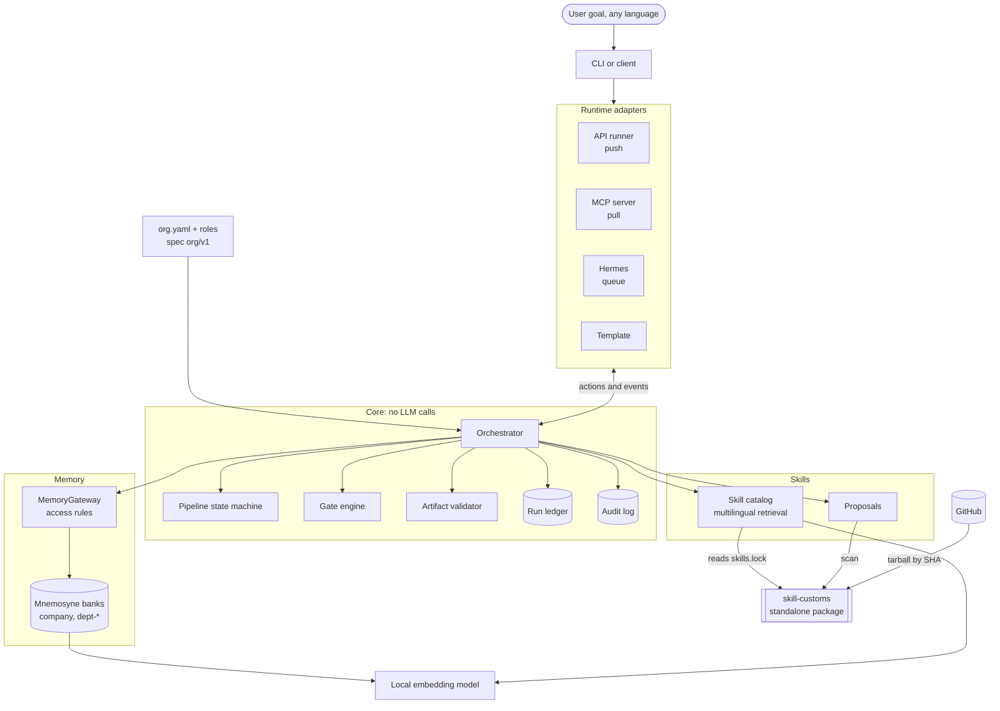
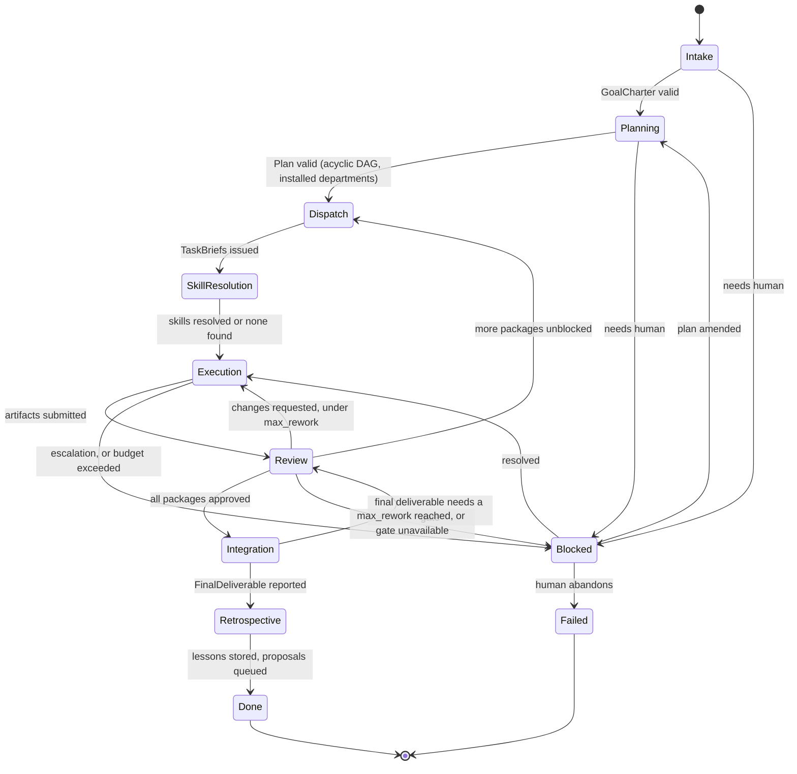
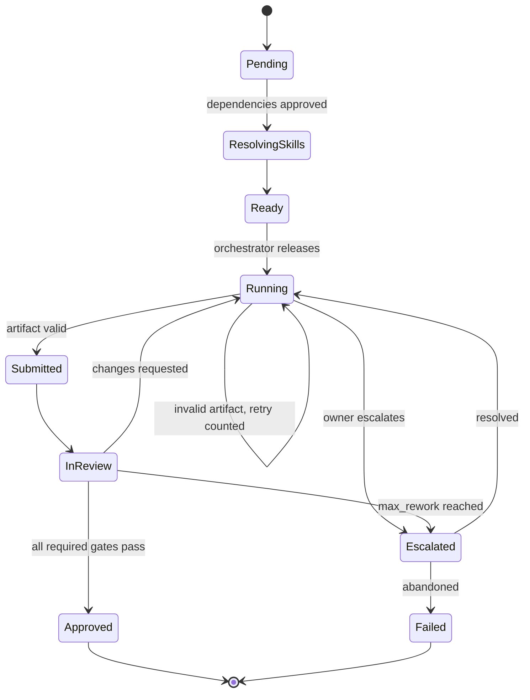
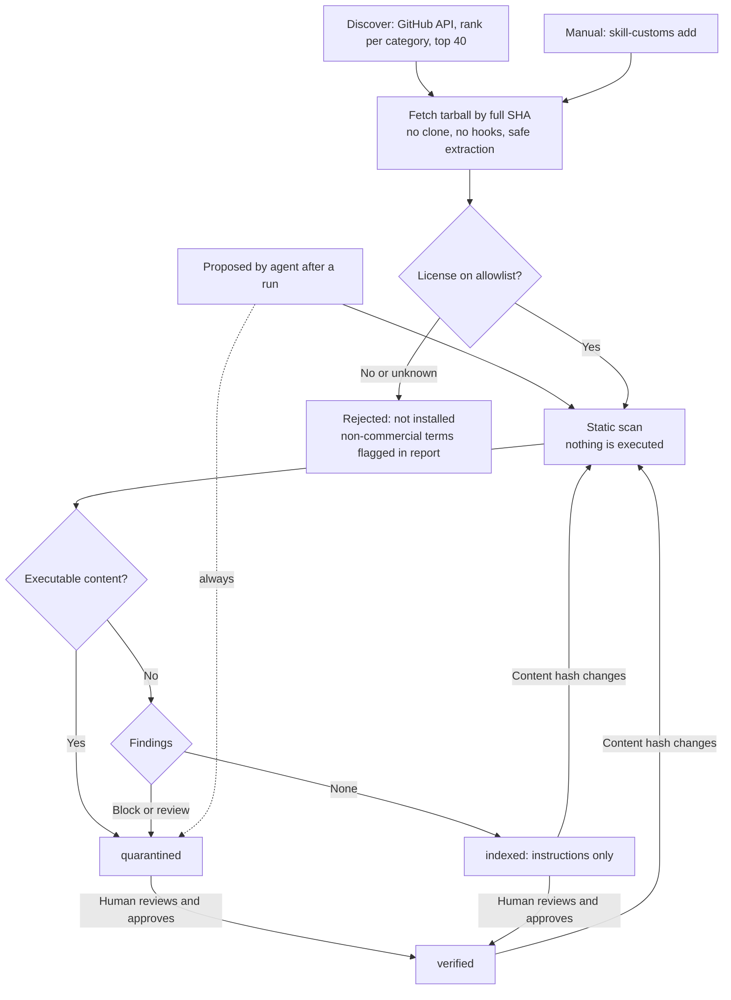
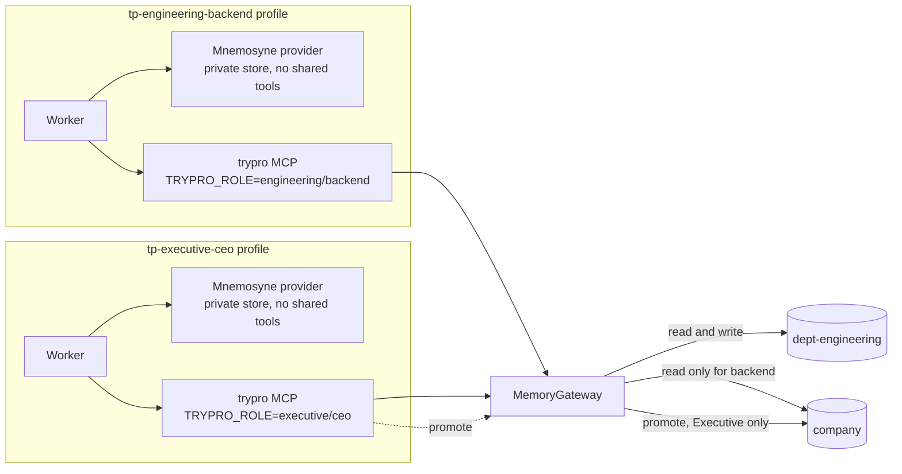

# Try Professional: Architecture (Phase 1)

**Status:** approved by the owner on 2026-11-06. Open questions are resolved in §14.
**Date:** 2026-11-06
**Upstream versions read:** `mnemosyne-memory` 4.0.0, `mnemosyne-hermes` 0.7.7, Hermes Agent `main` as of 2026-11-06.

Try Professional turns an LLM agent runtime into a structured company: a hierarchy of agents with one accountable owner per task, typed handoffs, review gates, shared multilingual memory and a vetted skill supply chain. It is designed against flat swarms.

## Contents

1. [Decisions so far](#1-decisions-so-far)
2. [Changes from the brief](#2-changes-from-the-brief)
3. [Directory tree](#3-directory-tree)
4. [Components](#4-components)
5. [Organization model and spec](#5-organization-model-and-spec)
6. [Pipeline state machine](#6-pipeline-state-machine)
7. [Artifact schemas](#7-artifact-schemas)
8. [Memory](#8-memory)
9. [Skill supply chain](#9-skill-supply-chain)
10. [Adapters](#10-adapters)
11. [Benchmark harness](#11-benchmark-harness)
12. [Phases and exit criteria](#12-phases-and-exit-criteria)
13. [Known limits](#13-known-limits)
14. [Resolved questions](#14-resolved-questions)
15. [Appendix: evidence](#15-appendix-evidence)

---

## 1. Decisions so far

| Topic | Decision | Source |
|---|---|---|
| Names | Display "Try Professional", repo `try-professional`, PyPI `try-professional`, import `try_professional`, CLI `trypro`. Free on PyPI, no conflicting GitHub project found. No trademark search done. | Owner |
| Runtime priority | API, then MCP, then Hermes. The Hermes design is fully specified here (§10.4); its implementation comes last. | Owner |
| Departments | All nine ship as removable packs. Installed does not mean invoked (§5.3). | Owner |
| Embeddings | Local. `paraphrase-multilingual-MiniLM-L12-v2` by default, confirmed after Phase 3. `multilingual-e5-large` is a documented optional upgrade ([docs/embeddings.md](embeddings.md)). | Owner |
| Score floor | Memory recall keeps one. The skill catalog has none. | Owner |
| Paid API calls | Before re-running anything that calls the paid API, tell the owner and wait, even with token ceilings in place. | Owner |
| Tokens per run | A first-class metric, reported in every live test and in Phase 6. The hierarchy must not cost much more than a flat swarm for the same result, or the README says so. | Owner |
| Skill licenses | MIT, Apache-2.0, BSD-2-Clause, BSD-3-Clause, ISC. Configurable. | Owner |
| Extra runtime stub | Generic `adapters/template/` only, with no named stub. | Owner |
| Supply chain | Standalone package in a monorepo. Try Professional depends on it like any other user. | Owner |
| `org.yaml` | Documented, versioned spec with JSON Schema. | Owner |
| Benchmarks | New Phase 6, `trypro bench`, results published even where the hierarchy loses. | Owner |
| Remote embeddings | Refused unless explicitly enabled (§8.4). | Proposed and accepted with the embeddings answer |
| Supply-chain name and position | `skill-customs`: the lockfile, license and pinning layer. Other scanners plug in, and ours is the default. | Owner |
| Skill index | Separate catalog outside Mnemosyne, same embedding model. Memory banks stay on Mnemosyne. | Owner |
| Benchmark spending | Decided after Phase 5. The estimate is shown first, and the approved amount is never exceeded. All three setups use the same mid-priced model. | Owner |
| Python | 3.10 to 3.13 required in CI. 3.14 allowed to fail until Mnemosyne officially supports it. | Owner |
| Repository | `goranai/try-professional`, private until v0.1.0. | Owner |
| LLM provider | Any OpenAI-compatible API, from `TRYPRO_LLM_BASE_URL`, `TRYPRO_LLM_API_KEY` and `TRYPRO_LLM_MODEL` in `.env`. Everyone uses these unless `llm_overrides` in `org.yaml` says otherwise. `OPENAI_API_KEY` is never used. | Owner |
| Model | `deepseek-v4.1-flash-1017`: passed tool calling, a tool loop and JSON output. Phase 6 uses the same model. | Owner's preference, confirmed by test |
| Secrets | `.env` is gitignored, and a scan of the working tree and full history runs before every push. | Owner |

## 2. Changes from the brief

| Brief | This design | Why |
|---|---|---|
| `core/`, `memory/`, `skills/` at repo root | `packages/<dist>/src/<import_name>/...` | Top-level packages named `core` and `memory` would collide in users' environments. A `src` layout also makes tests run against the installed package. |
| `org/` at repo root | Pack sources live inside the package. `trypro init` writes `org/org.yaml` and `org/roles/<department>/<role>.yaml` into the user's project. | The user's project gets exactly the layout in the brief, and `pip install` can ship the packs. |
| `skills/` subsystem | `packages/skill-customs/` | Owner's change. `skill-guard` was taken on PyPI (§14). |
| Skill index inside a Mnemosyne bank | Separate catalog using the same embedding model | Approved by the owner (§14). Evidence in §8.5. |
| Role agents write to their department bank (company bank writer unspecified) | Only the Executive department writes to the company bank, through an explicit promotion | Closes a gap in the brief. Anything else lets one role change what the whole company reads. |
| Phase 6 is OSS packaging | Phase 6 is the benchmark harness, Phase 7 is OSS packaging | Owner's change. |

## 3. Directory tree

```text
try-professional/
├── README.md                     # 60-second quickstart, architecture diagram, badges
├── LICENSE                       # MIT
├── CONTRIBUTING.md               # add a department, role, adapter, or skill
├── CODE_OF_CONDUCT.md
├── SECURITY.md                   # threat model and disclosure
├── GOVERNANCE.md
├── CHANGELOG.md                  # Keep a Changelog + SemVer, one section per package
├── THIRD_PARTY_SKILLS.md         # generated by skill-customs
├── .env.example
├── pyproject.toml                # workspace root; never published
├── spec/
│   ├── org-v1.schema.json        # canonical JSON Schema (draft 2020-12)
│   ├── role-v1.schema.json
│   ├── artifacts-v1/             # generated from the Pydantic models, checked in CI
│   └── conformance/{valid,invalid}/
├── packages/
│   ├── skill-customs/            # standalone; must not import try_professional
│   │   ├── pyproject.toml
│   │   ├── README.md             # adopt in under 5 minutes
│   │   ├── src/skill_customs/
│   │   │   ├── scan/             # scanner, rule packs, plugin interface
│   │   │   ├── license.py        # allowlist and commercial-use flags
│   │   │   ├── fetch.py          # tarball by SHA, safe extraction
│   │   │   ├── lockfile.py       # skills.lock
│   │   │   ├── discover.py       # GitHub ranking
│   │   │   ├── attribution.py    # THIRD_PARTY_SKILLS.md
│   │   │   └── cli.py
│   │   └── tests/
│   └── try-professional/
│       ├── pyproject.toml
│       ├── src/try_professional/
│       │   ├── org/              # loader, validator (spec levels 1 and 2)
│       │   ├── packs/            # one folder per department
│       │   ├── core/
│       │   │   ├── pipeline/     # pure state machine
│       │   │   ├── orchestrator.py
│       │   │   ├── artifacts/    # Pydantic models
│       │   │   ├── gates.py
│       │   │   ├── ledger.py     # run state in SQLite
│       │   │   └── audit.py      # append-only hash-chained log
│       │   ├── memory/           # MemoryGateway, Mnemosyne backend, fake backend
│       │   ├── skills/           # catalog, retrieval, proposals (uses skill_customs)
│       │   ├── adapters/         # base.py, api_runner/, mcp/, hermes/, template/
│       │   ├── bench/            # runner, setups, tasks, report generator
│       │   └── cli.py
│       └── tests/
├── examples/landing-page/
├── benchmarks/results/           # raw results by date, model, version
├── docs/
│   ├── architecture.md           # this file
│   ├── pipeline.md, security.md, i18n.md
│   ├── benchmarks.md             # generated, never edited by hand
│   ├── spec/org-v1.md            # normative spec
│   ├── adr/
│   └── research/                 # evidence behind design claims
└── .github/                      # CI, templates, CODEOWNERS, dependabot, seed-issues.yaml
```

**Tooling:** `uv` workspace for development (plain `pip install -e` also works), `hatchling` as the build backend, Python 3.10+. CI requires 3.10 to 3.13 on Linux, macOS and Windows. 3.14 runs in CI but is allowed to fail until Mnemosyne officially supports it.

**Dependencies:**

| Package | Required | Optional extras |
|---|---|---|
| `skill-customs` | `pyyaml` | none; HTTP uses the standard library |
| `try-professional` | `skill-customs`, `pydantic`, `pyyaml`, `jsonschema`, `httpx`, `mnemosyne-memory[embeddings]` | `[anthropic]`, `[mcp]`, `[bench]` |

There is no telemetry anywhere.

## 4. Components



The important boundary: **core makes no model calls.** It takes events, updates state and emits actions. Adapters perform the actions. This is what lets one pipeline serve all three runtime styles, and it makes the hierarchy rules testable without an API key.

## 5. Organization model and spec

### 5.1 Spec

`docs/spec/org-v1.md` is normative. `spec/org-v1.schema.json` and `spec/role-v1.schema.json` are the machine-readable contract, so other tools can read and write these files without importing this project.

- **Versioning:** every file declares `spec: org/v1` or `spec: role/v1`. The spec version is independent of package versions. Changes within v1 are additive only. A breaking change means `org/v2` and a migration command.
- **Reader rules:** must reject an unknown major version. Must ignore unknown `x-*` keys. Must reject other unknown keys.
- **Writer rules:** must preserve `x-*` keys.
- **Validation levels:** Level 1 is JSON Schema. Level 2 is semantic rules that JSON Schema cannot express: every role belongs to one department, each department has one head, escalation paths form a tree that ends at the CEO, a reviewer is never the owner they review, and gate references resolve.
- **Conformance:** `spec/conformance/` holds valid and invalid fixtures that any implementation can run. `trypro org validate` runs both levels.

### 5.2 Files

```yaml
# org/org.yaml
spec: org/v1
company:
  name: Example Co
root_role: executive/ceo
departments:
  - id: executive
    head: ceo
    activation: always          # always | on_demand
    roles: [ceo, chief-of-staff]
  - id: engineering
    head: tech-lead
    activation: on_demand
    qa_gate: { reviewer: qa }
    roles: [tech-lead, backend, frontend, devops, qa]
  - id: finance
    head: finance-lead
    activation: on_demand
    qa_gate: { reviewer: executive/chief-of-staff }   # one-role department, so the reviewer is outside it
    roles: [finance-lead]
gates:
  legal:
    reviewer: legal/counsel
    triggers: [public_facing, touches_license, touches_personal_data]
    on_unavailable: block       # fail closed if the Legal pack is removed
pipeline:
  max_parallel_tasks: 4
  max_rework: 2
  budget: { max_tokens_per_run: null, on_exceeded: escalate }
```

```yaml
# org/roles/engineering/backend.yaml
spec: role/v1
id: backend
department: engineering
mission: Build and maintain server-side features to spec.
responsibilities: [Implement APIs, Write tests for what it builds]
inputs: [TaskBrief]
outputs: [CodeChange, TaskReport]
allowed_tools: [workspace_read, workspace_write, memory_recall, memory_write, skill_search]
allowed_skill_categories: [backend, testing, databases]
escalation: engineering/tech-lead
reviewer: engineering/qa
model_tier: standard            # executive | standard | fast, mapped in user config
system_prompt: |
  You are the Backend Engineer...
```

### 5.3 Installed is not invoked

Installing a pack makes a department available. It costs nothing until it is activated.

- **Executive** is active on every run.
- **The Plan names the departments it activates**, each with a reason. A plan naming an uninstalled department is rejected, and the CEO must replan.
- **A department with no activation** gets no model calls, no memory opens, and no skill queries. Its Hermes profiles spawn no workers.
- **Gates do not depend on the plan.** They fire from rules (§6.3). If Legal was not activated and a trigger fires, the gate engine activates it and logs why. The CEO cannot avoid a gate by leaving a department out.
- **A missing gate department fails closed.** If the Legal pack was removed and a trigger fires, the run blocks and escalates to the human, unless the user set `on_unavailable` otherwise.
- **Under-activation is recoverable.** A head can escalate to the CEO, who issues a logged plan amendment.
- **Chief of Staff and Finance Lead are mostly deterministic.** Progress and token totals come from the ledger, so their models run only for escalations and explicit requests.

**Required tests** (Phase 2 unless noted):

| Test | Asserts |
|---|---|
| Code-only goal | Marketing and Sales have zero model calls, memory opens and skill queries, shown from the audit log |
| Code-only goal that handles personal data | Legal activates though the plan omitted it |
| Plan omits Legal for public-facing output | Output cannot reach `DONE` without Legal's verdict |
| Legal pack removed and trigger fires | Run blocks and escalates |
| Plan names an uninstalled department | Plan is rejected |
| QA gate | Always runs for an activated department, and owner never equals reviewer |
| Hermes, code-only goal (Phase 5) | No cards assigned to Marketing or Sales profiles |

## 6. Pipeline state machine

### 6.1 Run lifecycle



### 6.2 Task lifecycle



### 6.3 Gates

| Gate | Fires when | Reviewer |
|---|---|---|
| Department QA | Every task result | `qa_gate.reviewer`, never the owner |
| Legal | `public_facing`, `touches_license`, or `touches_personal_data` is true | `legal/counsel` |
| CEO sign-off | Final deliverable | `executive/ceo` produces it. A deterministic check then requires a result for every success criterion, and Legal reviews it if any flag is set anywhere in the run, including in the goal |

An agent could understate a trigger flag, so flags are the union of three inputs: what the owner declares, what the Plan declares for the package, and a deterministic check (e.g. the output type is `PublicContent`, a changed file is a license file, a schema field matches a personal-data pattern). A flag can be added but never cleared, and only by a human can a gate be waived. Waivers are logged. Legal output carries a notice that it is not legal advice.

### 6.4 Core invariants

These are enforced by the orchestrator and tested. They do not rely on prompts.

1. A task has exactly one owner, one definition of done and one reviewer.
2. A role can address only its own head or tasks assigned to it. Crossing departments requires a `Handoff` between heads, and it is logged.
3. Parallelism is decided only by the orchestrator: tasks with no dependency path, up to `max_parallel_tasks`.
4. An artifact that fails schema validation is not stored as a result.
5. Nothing reaches `Approved` without the required verdicts.
6. Every transition appends a hash-chained audit record, so later edits to the log are detectable. The ledger stores the latest hash, so removing records from the end is detectable too.
7. A run can't loop forever. Each repeat escalation of a task goes one level higher (head, then CEO, then human), and no new model call starts while a run waits for a human.
8. Only a human decision clears a blocked run. Results still in flight are accepted, but they don't unblock it.

### 6.5 How core stays runtime-agnostic

```python
def advance(state: RunState, event: Event, org: Org) -> tuple[RunState, list[Action]]: ...
```

`advance` is pure. Actions include `InvokeRole`, `RunGate`, `RecallMemory`, `AskHuman` and `Finish`. The ledger saves state after every event, so any run can resume after a crash or be advanced one tool call at a time.

## 7. Artifact schemas

Pydantic v2 models are the source of truth. JSON Schema is generated into `spec/artifacts-v1/`, and CI fails if the two drift.

**Envelope (all artifacts):**

| Field | Notes |
|---|---|
| `artifact_id`, `type`, `schema_version` | ID is a content-addressed hash |
| `run_id`, `task_id` | Task ID is null for run-level artifacts |
| `produced_by` | `department/role` |
| `attested_by` | `runtime` when the adapter fixed the identity, `claimed` when it is self-reported (§10.3) |
| `language` | BCP 47 tag |
| `parents` | Artifact IDs this one was derived from |
| `flags` | `public_facing`, `touches_license`, `touches_personal_data` |
| `payload` | Type-specific, below |

**Payloads:**

| Type | Producer | Key fields |
|---|---|---|
| `GoalCharter` | CEO | `original_goal`, `restated_goal`, `user_language`, `constraints[]`, `success_criteria[]` |
| `Plan` | CEO | `activated_departments[{id, reason}]`, `work_packages[{id, title, owner_department, depends_on[], acceptance[], flags}]` |
| `TaskPlan` | Head | `work_package_id`, `tasks[{id, title, owner_role, definition_of_done[], depends_on[], output_type, flags}]` |
| `TaskBrief` | Orchestrator, from a `TaskPlan` | `task_id`, `work_package_id`, `title`, `owner_role`, `reviewer_role`, `definition_of_done[]`, `depends_on[]`, `output_type`. The reviewer comes from the org, so a head can't choose who reviews its own team |
| `SkillResolution` | Orchestrator | `query`, `candidates[{skill_id, score, trust}]`, `selected[]`, `reason` |
| `TaskReport` | Role | `summary`, `outputs[]`, `done_criteria_met[{criterion, met, evidence}]`, `open_issues[]` |
| `CodeChange` | Engineering | `files[{path, sha256}]`, `tests[{command, result}]` |
| `PublicContent` | Marketing, Sales, Support | `audience`, `channel`, `locale`, `body_ref`, `claims[{claim, source}]` |
| `ResearchReport` | Research | `question`, `findings[{statement, confidence, sources[]}]` |
| `ReviewVerdict` | Reviewer | `gate`, `subject_artifact_id`, `decision` (`approve`, `changes_requested`, `block`), `issues[{severity, description}]` |
| `Handoff` | Head | `from_department`, `to_department`, `request`, `acceptance[]`, `artifact_refs[]`. Creates a work package in the other department, and the requester resumes when it is approved |
| `Escalation` | Any role | `reason`, `options[]`, `recommendation`, `blocking` |
| `EscalationResolution` | The role escalated to | `decision` (`resume`, `abandon`, `escalate_further`, `amend_plan`), `guidance`, `activate_departments[]`, `added_work_packages[]`. Only the root role can amend the plan |
| `FinalDeliverable` | CEO | `summary_in_user_language`, `artifact_refs[]`, `criteria_results[]`, `known_limits[]` |
| `Retrospective` | CEO | `lessons[]`, `procedures[]`, `skill_proposals[]` |

**Language:** schema keys are English. Free-text fields use the goal's language by default (`pipeline.working_language: auto`), and the final report always uses the user's language. CEO detects language as part of `GoalCharter`, so no separate language library is needed.

## 8. Memory

### 8.1 Banks and access

| Store | Read | Write | Backing |
|---|---|---|---|
| `dept-<id>` | Roles in that department | Roles in that department | Mnemosyne bank |
| `company` | All roles | Executive only, through `promote` with a source reference | Mnemosyne bank |
| Skill catalog | All roles, filtered by `allowed_skill_categories` | Orchestrator only | Separate catalog (§8.5) |

Reads and writes go through `MemoryGateway`. The caller's identity comes from the runtime context and is never a model-supplied argument. Every call is audited.

### 8.2 Backend boundary

`MemoryBackend` is a small protocol with a Mnemosyne implementation and a fake for unit tests. Mnemosyne is a dependency, not a fork: `mnemosyne-memory[embeddings]>=4,<5`.

### 8.3 Required Mnemosyne settings

Evidence for each is in §15.

| Setting | Value | Why |
|---|---|---|
| `MNEMOSYNE_EMBEDDING_MODEL` | MiniLM multilingual | Upstream's default is an English model, `bge-small-en-v1.5` |
| `MNEMOSYNE_EMBEDDING_DIM` | `384` | Must match the model |
| `MNEMOSYNE_LEXICAL_GATE_MIN` | `0` | **Critical.** With the default keyword gate, cross-language recall mostly returns nothing (5/40). With `0`, recall@5 was 37/40. |
| Dense score floor, memory only | 0.28 for MiniLM | With the gate off, nonsense queries return a full page of results, and recall results go straight into a task's context. **The floor is a weak filter:** on held-out queries it rejected 7 of 10 nonsense queries, because correct hits (as low as 0.283) and nonsense (as high as 0.336) overlap. It removes the worst noise, and can't detect "no match" reliably. |
| `MNEMOSYNE_DATA_DIR` | `$TRYPRO_HOME/memory` | Keeps data out of `~/.hermes` |
| `MNEMOSYNE_WM_TTL_HOURS`, `MNEMOSYNE_WM_MAX_ITEMS` | Effectively no limit | By default, unconsolidated rows are trimmed after 168 hours. Consolidating them instead could involve an LLM, so expiry is turned off. A test backdates a memory and confirms it survives. |

Mnemosyne's `config.yaml` can outrank the environment, and it falls back to keywords silently if embeddings are unavailable. So at startup `MnemosyneBackend` checks the effective values after import: the model, the expiry, whether embeddings are available, and that text stays local. Any failure stops memory from starting.

### 8.4 Keeping text local

Mnemosyne routes embeddings to a remote API when the model name looks like an API model, when `MNEMOSYNE_EMBEDDING_API_URL` is set to a non-OpenRouter URL, or when `MNEMOSYNE_EMBEDDINGS_VIA_API` is on. `MemoryGateway`'s backend checks these conditions at startup and refuses to start unless `memory.remote_allowed: true` is set in `trypro.yaml`. The only expected network call in the local path is the model download on first use, and `trypro init` does that up front, so the user sees it. A test blocks all sockets and confirms remembering and recalling still work, with `OPENAI_API_KEY` set.

### 8.5 Decision: the skill catalog is not a memory bank

The brief asked for a change like this to be proposed with evidence before switching, and the owner approved it. Memory banks stay on Mnemosyne. Only the skill index changes.

| | Mnemosyne bank (gate off) | Plain cosine, same model |
|---|---|---|
| Recall@5, 40 queries in 5 languages | 37/40 | 39/40 |
| Top-1 | 29/40 | 35/40 |
| English recall@5 | 6/8 | 8/8 |

That set was small, so a larger one followed in Phase 3 (200 queries, 100 of them held out). With a score floor on both, recall@5 was 91/100 for the catalog and 87/100 for the bank, and English 14/20 against 11/20. The structural reasons are still the stronger argument:

- A catalog entry should not be subject to working-memory expiry, consolidation or summarization.
- Recall updates `recall_count` and `last_recalled`, but catalog ranking should be deterministic for reproducible benchmarks.
- A catalog must filter on license, trust and category before ranking, which are structured columns rather than memory text.

**Implementation:** plain SQLite table with vectors stored as blobs, and NumPy cosine (already installed through `fastembed`). No new dependency. The catalog is rebuilt from `skills.lock`, so it holds no state of its own. **The catalog has no score floor.** The floor cost 2 of 100 held-out hits, both in English, in return for filtering out noise that a skill search can tolerate: a weak suggestion carries its score and an agent can ignore it, while a filtered-out skill is lost for good. Without it, nonsense queries also get results, each with a low score.

Phase 4 fills the catalog from `skills.lock`. Evidence: [`docs/research/phase3-retrieval/`](research/phase3-retrieval/).

### 8.6 Model selection

| Model | Dimensions | Download | fastembed support | Status |
|---|---|---|---|---|
| `paraphrase-multilingual-MiniLM-L12-v2` | 384 | 0.22 GB | Yes | Default |
| `intfloat/multilingual-e5-large` | 1024 | 2.24 GB | Yes | Documented upgrade; needs `query:`/`passage:` prefixes |
| `BAAI/bge-m3` | not verified | not verified | Not in the lists I checked | Phase 3: measured only if it can run with an optional dependency |

Sizes come from fastembed's model tables. Changing models changes the vector space, so memory and the catalog refuse to open with a different model than they were built with. Moving existing memories to a new model isn't built yet.

**Phase 3 results for the catalog with MiniLM and no floor,** on 100 held-out queries:

| Language | Recall@5 | Review status |
|---|---|---|
| Indonesian | 20/20 | Pending the owner's review |
| Spanish | 19/20 | Not natively reviewed |
| Chinese | 19/20 | Not natively reviewed |
| Arabic | 19/20 | Not natively reviewed |
| English | 16/20 | Not needed |
| **Total** | **93/100** | |

**The 80% target is met in every language, English only just.** Because the held-out set had been seen when the floor was removed, English was confirmed on 20 fresh queries written before measuring: 16/20, exactly at the target. The same author wrote both, so this isn't independent. The languages aren't directly comparable either, because the English queries are the most idiomatic in the set. These are hand-written queries over a 40-skill catalog, so they show the approach works, and they aren't a claim about general accuracy.

`e5-large` scored 98/100 on the same queries, at about 10 times the download and 2.6 times the memory. See [docs/embeddings.md](embeddings.md).

## 9. Skill supply chain

### 9.1 Package

`skill-customs` is the lockfile, license and pinning layer for agent skills. It is not positioned as another scanner: other scanners plug in, and ours is the default. It works with no Try Professional code installed, with a CLI and a Python API.

```text
skill-customs scan ./my-skill            # findings; exit 0 pass, 1 review, 2 block
skill-customs license ./my-skill         # allowlist verdict and commercial-use flag
skill-customs add owner/repo --path skills/foo --commit <40-hex>
skill-customs resolve owner/repo@main    # prints a SHA; installs nothing
skill-customs verify                     # CI: installed tree matches skills.lock
skill-customs approve <skill-id>         # human only; binds to the content hash
skill-customs list | attribution | discover
```

```python
from skill_customs import Policy, Lockfile, scan, check_license, pin

policy = Policy.default()
report = scan("./my-skill", policy)
verdict = check_license("./my-skill", policy)
entry = pin("owner/repo", path="skills/foo", commit="<40-hex>", dest="./skills", policy=policy)
Lockfile.load("skills.lock").add(entry).save()
```

**Enforced separation:** a CI job installs `skill-customs` alone in a clean environment and runs its tests. A test fails if it imports `try_professional`, and another fails if `try_professional` uses anything outside its public API.

### 9.2 Vetting flow



### 9.3 Details

**Fetching.** Only a full 40-character SHA is accepted. Branches and tags are rejected, and `resolve` exists to turn a ref into a SHA explicitly. Archives are fetched by tarball, so no git hooks can run. Extraction rejects symlinks, path traversal and oversized files.

**License gate.** Reads the SPDX ID from the skill's frontmatter, its own `LICENSE`, and the repo `LICENSE`. If they disagree, the stricter reading applies. An unknown license is rejected. `THIRD_PARTY_SKILLS.md` is generated from the lockfile.

**Scanner.** Looks for embedded instructions to exfiltrate data, override system prompts, fetch remote code, or touch credentials. It also flags hidden Unicode (tag characters, bidirectional controls), encoded blobs, and executable content (`scripts/`, shebangs, script extensions, `curl | sh` patterns in code fences). Rule packs cover at least English, Indonesian, Spanish, Chinese and Arabic, because an English-only scanner would be easy to bypass in a multilingual framework. External scanners can be added through a plugin interface.

**Trust.** `quarantined`, `indexed` and `verified`, as in the brief. An approval records who approved and the content hash, so any change to the content drops the approval.

**Approval is human-only.** `approve` is a CLI command. It is not exposed as an MCP tool or agent tool, and a test asserts this. Agent-proposed skills land in `skills/proposed/` as `quarantined`.

**Runtime treatment.** Skill text is data, so it is delivered inside a labelled untrusted block. Prompts tell the model it cannot override role or tool rules, but **delimiters reduce prompt injection rather than prevent it.** The real barrier is that tool permissions are enforced by the runtime from the role file, whatever the model was persuaded to attempt. A passing scan means no known signal was found. It does not mean a skill is safe, and the docs will say so.

**Discovery.** Ranks by stars, recency, and maintenance signals (recent commits, open-issue ratio, repo age, license present). Stars can be bought, so ranking only nominates candidates, and every candidate still passes the gates. No daemon runs: refresh uses a schedule the user controls, with a GitHub Action template provided.

### 9.4 `skills.lock`

JSON with sorted keys for clean diffs.

```json
{
  "lock_version": 1,
  "skills": {
    "owner/repo/skills/seo-audit": {
      "source": { "host": "github.com", "repo": "owner/repo", "path": "skills/seo-audit", "commit": "<40-hex>" },
      "content_sha256": "<hash of normalized tree>",
      "license": { "spdx": "MIT", "evidence": "repo:LICENSE", "commercial_use": "allowed" },
      "trust": "indexed",
      "scan": { "scanner_version": "0.1.0", "ruleset": "2026.11", "findings": [] },
      "approval": null
    }
  }
}
```

### 9.5 README and adoption

The README opens with a working flow under 5 minutes: install, scan a folder, add a pinned skill, run `verify` in CI. It has short sections for CrewAI, Hermes and MCP clients. Each of those gets a seeded `good first issue`. Where a framework's skill-loading details aren't yet verified, the issue begins by confirming them.

## 10. Adapters

### 10.1 Interface

Runtimes differ in who owns the loop, so the interface states that explicitly.

```python
class RuntimeAdapter(Protocol):
    name: str
    mode: Literal["push", "pull", "queue"]

    def capabilities(self) -> Capabilities: ...  # identity attestation, tool enforcement, parallelism
    def provision(self, org: Org, home: Path) -> ProvisionReport: ...
    def verify(self) -> VerifyReport: ...  # used by each adapter's smoke test
    def deliver(self, action: Action) -> Delivery: ...
    def collect(self) -> Iterable[Event]: ...
```

| Mode | Who runs the model | Example |
|---|---|---|
| `push` | The adapter calls the model and returns the result | API runner |
| `pull` | The client asks for the next action, does it, and submits | MCP |
| `queue` | The adapter enqueues, and a worker picks it up later | Hermes |

`adapters/template/` is a copyable, tested implementation with a README and smoke test.

### 10.2 API runner

Provider-agnostic config with `anthropic` and `openai_compatible` clients. By default every role uses the `TRYPRO_LLM_*` values from the environment or `.env`, and `llm_overrides` in `org.yaml` can give a department or role its own model, key variable, or endpoint (see the [spec](spec/org-v1.md#model-overrides)). A role's override wins over its department's, one field at a time. An override with a new endpoint must also name its key variable, so a shared org file can't quietly send the default key elsewhere. Keys come only from environment variables, and are redacted from provider error messages. Identity is attested and tool permissions are fully enforced. There is no shell tool yet. A Docker-backed one is planned as opt-in.

- **Anthropic** uses the official `anthropic` SDK as an optional extra (`try-professional[anthropic]`), rather than raw HTTP as first proposed. That API changes quickly, and the SDK tracks it.
- **OpenAI-compatible APIs** (OpenAI, Grok, local servers) use `httpx` directly, so they need no extra dependency.
- **Refusal fallbacks:** the default Anthropic config sets `fallbacks: default`, which lets the API retry a declined request on another model. The audit log records the model that answered. Set `fallbacks: null` to turn it off.
- **Artifacts are submitted through a tool.** Current Claude models reject forced tool choice, so the runner uses automatic tool choice with a prompt instruction, and validates every submission itself. This works the same on every provider.

### 10.3 MCP server

Tools: `org_get`, `run_start`, `run_status`, `run_next_action`, `artifact_submit`, `review_submit`, `handoff_request`, `escalate`, `memory_recall`, `memory_write`, `memory_promote`, `skill_search`, `skill_get`, `audit_tail`. It uses stdio by default.

Two identity modes:

- **Bound:** started with `TRYPRO_ROLE`, so identity comes from the server's launch config and is recorded as `attested_by: runtime`. Hermes uses this.
- **Operator:** one client plays whichever role `run_next_action` names, which suits Claude Code or Cursor. This is recorded as `attested_by: claimed`. The ordering, schemas and gates remain enforced, but separation between roles is procedural, because one model is playing all of them. The docs and audit log state this plainly.

### 10.4 Hermes

Verified against Hermes and Mnemosyne docs and source on 2026-11-06. Items marked ⚠ need a live test in Phase 5. Hermes is not on this machine's PATH, so nothing here has been run against it yet.

**Org chart to profiles.** One profile per role, 22 by default, named `tp-<department>-<role>` with `tp-executive-ceo` on top. `trypro hermes install` runs `hermes profile create <name> --description "<mission>"` and generates each profile's files from `org.yaml`, so it remains the only source of truth:

| Profile file or setting | Generated from |
|---|---|
| `SOUL.md` | Role `system_prompt` |
| `config.yaml`, model | Role `model_tier` |
| `memory.provider: mnemosyne` | Fixed |
| `memory.mnemosyne.tools` | Allowlist without any `mnemosyne_shared_*` tool |
| `mcp_servers.trypro` | `TRYPRO_ROLE`, `TRYPRO_HOME`, and `tools.include` from `allowed_tools` |
| `skills.external_dirs` | `verified` skills for the role's categories only |

**Why profiles and not one profile with subagents.** Hermes warns never to point two agents at one profile, and `delegate_task` children are anonymous with flat depth by default. Profiles provide the named identity the design needs.

**Delegation uses Kanban, not `delegate_task`.** The Kanban board is durable and shared across profiles, with one assignee per card, dependency edges and a review state, which match the pipeline closely.

| Pipeline | Kanban |
|---|---|
| Run | One board |
| Work package | Card assigned to the department head |
| Task | Card assigned to the role, with `parents` from the DAG |
| Review gate | `kanban_request_review` / `kanban_request_changes`, with the reviewer profile named |
| Artifact | `artifact_submit` through the `trypro` MCP tools; the card stores the artifact ID |
| Installed, not invoked | No card means no worker, and no gateway per role |

**Hierarchy enforcement.** Hermes describes its Kanban coordination as peer-based: any profile can read and write any task, and workers avoiding fan-out is a convention. So Hermes can't enforce the hierarchy alone:

1. Heads and the CEO create work through `trypro` tools, which validate against the org and then call Hermes.
2. A reconciler compares the board with the ledger and treats any unknown card as a logged violation.
3. Integration accepts only artifacts tied to tasks in the ledger, so an unsanctioned card can't reach the final deliverable.

**Sharing the company bank despite profile isolation.** I checked `docs/hermes-integration.md` as you asked. Its model has two pieces:

- Separate profile homes get separate private stores. This is what isolation means, and one shared plugin install shares code but not memory.
- The supported sharing path is the **shared surface**: profiles set the same absolute `shared_surface_path`, then use `mnemosyne_shared_*` tools or `shared_surface_read`.

The shared surface alone cannot satisfy your access rules, for three reasons:

- **One surface per profile.** A role needs two shared stores, company and department.
- **Any role can write.** `mnemosyne_shared_remember` would let any role write to it, against the rule that roles write only to their department bank.
- **The default path is already global.** The installable provider defaults to `~/.mnemosyne/data/shared/mnemosyne.db`, so without configuration it is a single store for all profiles.

**Design:** use Mnemosyne's isolation for private memory, and route organizational memory through `trypro`.



- **Private layer.** Each profile keeps its own Mnemosyne store through the native provider, which respects Hermes's rule. `memory.mnemosyne.tools` removes the `mnemosyne_shared_*` tools, so the global default surface is unreachable through them. `shared_surface_read` stays `false`. The filter applies to provider-exposed tools; as defense in depth, each profile also gets its own `shared_surface_path`.
- **Organizational layer.** Company and department banks live under `$TRYPRO_HOME/memory`. They are reachable only through `MemoryGateway`, which is opened by the `trypro` MCP server with identity fixed by that profile's launch config. This enforces read-company, read-own-department and write-own-department. Only Executive can promote into `company`.
- **Context injection.** Mnemosyne's automatic `prefetch` sees only the private store, so the orchestrator retrieves department and company context at dispatch and puts it in `TaskBrief.memory_context`. This works identically on every runtime, and the context used is auditable.
- **Rejected alternative.** A separate shared-surface file per department with company access through the gateway only is workable but splits organizational memory across two mechanisms, for no gain.

**Install and verify.** The install script performs these steps. The verification step fails if any of them is wrong.

1. Check for Hermes at or above the version required by the Mnemosyne catalog entry (`>=0.21.4`).
2. Create or update the 22 profiles.
3. In each: `hermes -p <name> plugins install mnemosyne`, then `hermes -p <name> config set memory.provider mnemosyne`.
4. Write the generated config.

```text
trypro hermes verify
  ✓ hermes --profile <name> memory status      provider active in each profile
  ✓ mnemosyne_diagnose                         private database path differs per profile
  ✓ no mnemosyne_shared_* tool in any profile
  ✓ trypro MCP reports the expected role per profile
  ✓ write from backend, read from QA           visible within the department
  ✓ write from backend, read from marketing    not visible
  ✓ backend writes to company                  refused
  ✓ CEO promotes, marketing reads              visible
  ✓ code-only goal                             no Marketing or Sales cards
```

**⚠ To confirm in Phase 5:**

- Concurrent cards for one assignee (the two-agents-one-profile warning suggests limiting to one per role, which `trypro` can enforce by holding cards back).
- Exact board commands, and which profile's gateway hosts the dispatcher.
- Whether Hermes's Skills Hub lock can coexist with `skills.lock` (`external_dirs` should avoid the conflict).
- Whether a `verified` skill loaded through `external_dirs` is treated as instructions. This is why only `verified` skills go there, and `indexed` skills are reached only through `skill_get` as untrusted data.
- Native Windows behavior for the whole flow.

**Fallback.** If live testing breaks this design, I'll report it before changing direction.

## 11. Benchmark harness

### 11.1 Task suite

25 tasks (within your 20-30 range), frozen before the first scored run, with the suite's hash recorded in every result. Mix: coding, content, research, and a proposal with a legal check.

| Check type | Example |
|---|---|
| Automatic | Hidden tests pass; output validates against a schema; required facts appear |
| Rubric | A separate judge model scores a published rubric, blind to which setup produced the output |

Each task has a `tasks/<id>/` folder with fixtures, prompt, check and declared check type. Rubric results are reported separately from automatic ones, because they are less objective.

### 11.2 Setups

All three use the same mid-priced model, plus the same tools, tasks, and per-task resource cap. Refusal fallbacks are turned off, because they could switch models mid-run. A refusal counts as a failed step.

| Setup | Definition |
|---|---|
| `single` | One agent with all tools and a neutral system prompt |
| `swarm` | The same role prompts as peers, sharing a message board, any agent can message any other, terminating on consensus or at the cap |
| `hierarchy` | Try Professional with the default org |

The swarm has to be a fair baseline, or the comparison is worthless. It gets the same role prompts, and its implementation is published with a design note. Contributors can challenge it, and improvements are welcome even if they make the hierarchy look worse.

### 11.3 Metrics

From one shared event format, recorded by the shared LLM client wrapper:

- Success rate.
- **Tokens per run, as a headline number:** total, by role, cached if the provider reports it, and tokens per successful task. Failed runs still count their tokens. Cost comes from provider-reported usage, with the price table and date recorded in the results.
- Wall-clock time.
- Failed or redone steps: invalid outputs, failed tool calls, rework loops and retries. The counting rule is defined per setup before the first run.

Each setup runs each task at least 5 times, giving 375 runs at the default. Reports show the mean, standard deviation and bootstrap confidence intervals, with paired per-task comparisons. Per-task tables are always included.

### 11.4 Skill-retrieval benchmark

Recall@5 for the same labelled skills queried in English, Indonesian, Spanish, Chinese and Arabic, broken down by language. It needs no LLM key and also runs in CI.

- **Compared:** MiniLM and e5-large (bge-m3 if practical), with Mnemosyne hybrid and plain cosine.
- **Query set:** larger than the Phase 1 set and split into development and held-out queries. Thresholds are tuned only on the development split.
- **Query files:** one file per language, each with a review status. The owner, a native Indonesian speaker, reviews the Indonesian file. The others stay labelled as unreviewed until a native speaker reviews them, and the report shows that label.

### 11.5 Reproducibility and honesty rules

- `trypro bench` runs everything. `--estimate` prints the run count and an estimated cost and spends nothing. Paid runs require `--max-cost`, and the harness stops before a call that could exceed it. `--suite retrieval` needs no LLM key.
- **Spending rule:** the budget is decided after Phase 5. The estimate is shown to the owner first, nothing is spent before approval, and the approved amount is never exceeded.
- Results go to `benchmarks/results/<date>-<model>-<version>/`, with raw events, config and suite hash.
- `docs/benchmarks.md` is generated from those raw results and always shows the model, date and version. CI fails if it doesn't match.
- There is no flag to exclude tasks or setups from a report. Failed and aborted runs count as failures. Results are published wherever the hierarchy loses.
- The README has no benchmark numbers, only a link to `docs/benchmarks.md`. CI enforces this with a lint rule.
- **If the hierarchy costs much more than the flat swarm for the same result, the README says so** in words, next to that link. Reducing tokens per run is ongoing work, and each live test reports them.
- **Paid runs wait for approval.** `--estimate` is free. Everything else that calls the paid API is announced to the owner first.
- A `--mock` mode replays recorded responses to test the harness in CI. Its output is marked as mock and can't be published.

**What "reproduces" means:** model outputs aren't deterministic and hosted models change over time. The command reruns the exact procedure, and results should agree within the reported variance, not digit for digit. The docs will say this.

## 12. Phases and exit criteria

Nothing is marked complete without passing tests. Each phase ends with what was built, what was tested and what is missing.

**Status (2026-11-06):** Phases 1 to 3 are complete. Phase 2 has run end to end on a live provider. Phase 3's memory stack has run with a scripted model, not a live one.

| Phase | Builds | Exit criteria |
|---|---|---|
| 1 | This document | Your approval |
| 2 | Org spec and JSON Schema, org loader, packs, pipeline, artifacts, audit, API runner, `trypro init` | Conformance fixtures pass; invariants and §5.3 tests pass; an end-to-end run against a scripted model client passes, plus one against a real provider if a key is available |
| 3 | Memory gateway, Mnemosyne backend, skill catalog | Cross-lingual tests pass for the 5 languages; access-rule tests pass; expiry and remote-refusal tests pass; model choice confirmed or reopened |
| 4 | `skill-customs` | Passes alone in a clean environment; malicious-skill fixtures are caught; license, pinning and lockfile tests pass; approval unreachable by agents |
| 5 | MCP and Hermes adapters, landing-page example | Each adapter's smoke test passes; `trypro hermes verify` passes against a real Hermes install; the ⚠ list in §10.4 is resolved |
| 6 | Benchmark harness and first results | `trypro bench` reproduces; `docs/benchmarks.md` is generated from raw results |
| 7 | Docs, CI, templates, seeded issues, releases | Clean-machine install works on all 3 operating systems; CI is green; publishing to PyPI and creating issues happen only after your explicit go-ahead |

**CI (Phase 7, added incrementally from Phase 2):** lint and type checks, tests, secret scanning, dependency audit, `skill-customs verify` and scan on every PR, spec and artifact-schema drift checks, the isolation job and the README claims lint.

**Seeded issues** (`.github/seed-issues.yaml`, created only when you approve): new department packs (Customer Success, HR, Data), `skill-customs` integrations with CrewAI, Hermes and MCP clients, new adapters, new language tests and scanner rule packs.

**ADRs to write:** core without LLM calls; hierarchy over swarm; Kanban for Hermes; organizational memory through a gateway; skill catalog separate from memory; monorepo split; embedding default; spec versioning.

## 13. Known limits

- **A real run costs more than the step count suggests.** The smallest live run took 15 model calls and about 44,000 tokens on `deepseek-v4.1-flash-1017`, for 7 steps. Writing and reading files, rejected outputs, and resending context each add calls. New companies get a default ceiling of 200,000 tokens per run. Prompts were then cut by 23% (`scripts/measure_prompts.py`), which hasn't been re-measured on a live run. A test holds prompts to a size budget.
- **Neither search can reliably say "no match".** See §8.3 and §8.5. An agent can still receive a low-relevance skill, labelled with its score, or weak memory above the floor.
- **Access rules are policy, not a security boundary.** A role with a shell tool could open the SQLite files directly on the same machine. The rules prevent accidents and ordinary misbehavior. Containers are required for stronger isolation.
- **The hierarchy may not win.** It will probably cost more tokens than a single agent on simple tasks. The benchmark exists to measure that.
- **Static scanning can be bypassed.** Paraphrased injection will get past rules. That's why trust levels, runtime tool limits and human review exist.
- **In MCP operator mode, one model plays every role.** Reviewer independence is weaker there and is labelled as such.
- **Agent counsel is not a lawyer.** Legal gate output is a check, not legal advice.
- **Upstream movement.** Mnemosyne and Hermes both change quickly. Versions are bounded, and the `MemoryBackend` and `RuntimeAdapter` boundaries limit the impact.
- **Quickstart timing is unproven.** The model download adds time to `trypro init`, and the README's "60 seconds" claim has to be measured on a clean machine, or it gets reworded.

## 14. Resolved questions

All were resolved by the owner on 2026-11-06.

| # | Question | Decision |
|---|---|---|
| Q1 | Name for the supply-chain package, given `skill-guard` is taken on PyPI | `skill-customs` |
| Q2 | Build it, given the existing tools? | Yes, as the lockfile, license and pinning layer. Other scanners plug in, and ours is the default. |
| Q3 | Separate skill catalog? | Yes, outside Mnemosyne with the same embedding model. Memory banks stay on Mnemosyne. |
| Q4 | Benchmark model and budget | Decided after Phase 5, with `trypro bench --estimate` shown first. Nothing is spent before approval, and the approved amount is never exceeded. The same mid-priced model is used for all three setups. |
| Q5 | GitHub owner | `goranai/try-professional`, private until v0.1.0 |
| Q6 | Translated test queries | Written by the maintainer agent, one file per language. The owner reviews the Indonesian file as a native speaker. |

**Tools reviewed for Q2**, from their READMEs and metadata on 2026-11-06, not an audit:

| Project | What it showed | Gap for this design |
|---|---|---|
| `vaibhavtupe/skill-guard` (6 stars, Apache-2.0 badge, Python) | PR gate: validate, scan, conflict detection | SHA pinning and a license allowlist not evident |
| `T-Zevin/SkillGuardrail` (57 stars, Apache-2.0, Go) | Quarantine, scan, policy, install | Not a Python API; guarded install not yet on Windows |
| `nbsp1221/skillpin` (0 stars, MIT, TypeScript) | SHA pinning, lockfile | Linux only |
| `bruc3van/agent-skills-guard` (392 stars) | Desktop scanning app | Not a library |
| Hermes Skills Hub | Quarantine, scan, lock file | Hermes only |

## 15. Appendix: evidence

Scripts and raw output are in [`docs/research/phase1-memory-spike/`](research/phase1-memory-spike/). This was a throwaway feasibility test, **not a benchmark**: 40 hand-written queries, written by me without native review, single run, one model.

**Environment:** Windows 11, Python 3.14.7, `mnemosyne-memory` 4.0.0, `fastembed` 0.9.1, MiniLM multilingual. Mnemosyne's PyPI classifiers stop at 3.13, but it installed and ran here. That's a single small test, not a claim of full support.

**Set:** 40 English-described skills, 8 labelled targets, 32 distractors with some deliberately close. 8 queries in each of 5 languages.

| Config | Top-1 | Recall@5 | Results for 4 nonsense queries |
|---|---|---|---|
| Mnemosyne defaults | 5/40 | 5/40 | 0, 0, 0, 0 |
| `LEXICAL_GATE_MIN=0` | 29/40 | 37/40 | 5, 5, 5, 5 |
| Plain cosine on the same embeddings | 35/40 | 39/40 | Not measured; it has no floor either |

| Recall@5 by language (n=8 each) | en | id | es | zh | ar |
|---|---|---|---|---|---|
| Mnemosyne, gate 0 | 6 | 8 | 8 | 7 | 8 |
| Plain cosine | 8 | 8 | 8 | 7 | 8 |

Other observations:

- Setting `EM_VEC_ADMIT=0.35`, `VEC_TYPE=float32` or vector-only weights on top of gate 0 changed none of these totals. These rows were in working memory, so the episodic admission floor likely doesn't apply, but I didn't investigate why the weights changed nothing.
- Bank isolation held in a separate 8-skill run: a memory in one bank was recalled from that bank and not from another, with distinct database files.
- The cause of the default result is in the code: `_minimum_recall_relevance` in `mnemosyne/core/beam.py` applies a lexical gate. This is sensible for single-language use, and not a Mnemosyne defect. It's a setting this project has to change.
- The test wrote only to temporary directories. `~/.hermes` had no new files and `~/.mnemosyne` wasn't created.

**Sources read:** Mnemosyne `docs/hermes-integration.md`, `integrations/hermes/README.md`, `integrations/hermes/src/mnemosyne_hermes/__init__.py`, `mnemosyne/core/{banks,memory,beam,embeddings}.py`; Hermes `website/docs/user-guide/{profiles,profile-distributions}.md`, `features/{kanban,delegation,mcp,skills,memory-providers}.md`, `AGENTS.md`, `agent/memory_provider.py`, `plugin-catalog/mnemosyne.yaml`; fastembed's model tables.
