# Try Professional

[](https://pypi.org/project/try-professional/)
[](https://github.com/goranai/try-professional/actions/workflows/ci.yml)
[](LICENSE)
[](https://pypi.org/project/try-professional/)

**An agent, but a company.** You talk to the CEO. Managers split the work, workers do it with real tools, QA and managers check it, and the CEO answers you. Every role is a full agent, with its own memory and skills.

**Preview: proven on Claude only.** It works, and it has rough edges. [What was tested](#what-was-tested-and-how).

You say what you want, and a company is designed for it: departments, roles, and skills from GitHub that are checked before they're used. You approve it, and then you talk to it, from the terminal, from Claude Code, or from Telegram. It works when you ask, and it remembers: every role, from the CEO down, keeps its own memory, and lessons from each job carry into the next.

**Two engines:**
- **Claude Code,** on your Claude plan. This is the most tested.
- **Its own engine,** with any OpenAI-compatible key, such as DeepSeek, Grok, or OpenAI: `trypro chat`. Cheap models finish less often today.

| Talk to it | How |
|---|---|
| Claude Code | Open the company's folder in Claude Code, and say what you want |
| The terminal | `trypro chat` |
| Telegram | `trypro telegram`, with a bot token in `.env` |

## Who it's for

**Anyone who wants a team of agents, organized like a professional company:** you give the CEO a job, a department's manager hands it to a worker, the worker does it with real tools (the shell, `git` and `gh`, files, and the web), QA and the manager check it, and the CEO reports back to you. Each role remembers its own work, uses its own skills, and leaves an audit trail.

**For an everyday one-off task, use a single agent.** It's cheaper and faster. A hierarchy spends tokens on reviews, and that's only worth it when a mistake would reach someone outside.

## Demo



A real run on 2026-11-08, on Sonnet through Claude Code. Waiting is cut, and each cut says how long it was. Long output is shortened, and marked. Claude Code ran non-interactively, and a script answered the real review screen, standing in for the person who approves. [How it was recorded](https://github.com/goranai/try-professional/blob/main/docs/research/demo/README.md).

## What a company makes

These are real, from [the journey](https://github.com/goranai/try-professional/blob/main/docs/research/journey/README.md). This catering company was designed from one line, "a catering business that delivers office lunches", and approved:

```text
Catering
├── Executive:  CEO (head) · Chief of Staff
├── Operations: Ops Lead (head) · Support · Menu Planner · Delivery Scheduler
├── Finance:    Finance Lead (head)
├── Marketing:  Marketing Lead (head) · Content Writer
├── Sales:      Sales Lead (head) · Proposal Writer
└── Legal:      Counsel (head) · Compliance Reviewer
```

Asked for "a weekly lunch menu and a price list for a new office client with 30 people", its menu planner wrote this. The ops lead approved it for QA, and Counsel for Legal:

```text
Mon - Lemon-herb grilled chicken, rice pilaf, green salad. Allergens: none of the 14 major allergens in the base
      recipe (check stock cube/dressing). Halal: yes if halal-certified chicken is sourced. Not vegetarian.
Tue - Vegetable lasagna with side salad. Vegetarian. Allergens: gluten, milk, egg, celery.
Wed - Chickpea & spinach coconut curry with basmati rice. Vegan, vegetarian, halal, gluten-free.
...
PRICE LIST (USD, excl. tax and delivery)
Item | Per person | Total for 30
Mon Chicken pilaf | 11.50 | 345.00
...
WEEK TOTAL | 55.50 | 1,665.00
```

It says what it doesn't know: prices are placeholders, and the allergen notes are for a kitchen to confirm. [The whole menu](https://github.com/goranai/try-professional/blob/main/docs/research/journey/deliverables/catering/large/operations-menu-planner-wp1-t1.md), and [its index](https://github.com/goranai/try-professional/blob/main/docs/research/journey/deliverables/catering/large/index.md).

It works in the command's language. For a banana-chip business in Indonesia, asked about shipping to Surabaya, a reply that names no rate it doesn't have:

```text
Halo Kak, terima kasih sudah menghubungi kami! Kami kirim ke Surabaya. Besar ongkir tergantung berat pesanan
dan kurir yang dipilih. ...
```

[The whole reply](https://github.com/goranai/try-professional/blob/main/docs/research/journey/deliverables/umkm-snacks/small/customer-care-care-lead-wp1-t1.md), and [a two-week Instagram plan in Indonesian](https://github.com/goranai/try-professional/blob/main/docs/research/journey/deliverables/umkm-snacks/large/marketing-campaign-writer-wp1-t1.md).

## Quickstart

For Claude Code. You need Python 3.10 or newer, and Claude Code signed in. It uses your own Claude plan, with no API key, and each role runs as its own subagent.

```bash
pip install "try-professional[mcp]"
mkdir my-company && cd my-company
trypro start "a weekly newsletter for my yoga studio's members"
```

Say what you want made, in your own words. `trypro start` checks your setup, has Claude Code design a company that can do it, and shows you that company to approve: type `a`, then `approve`. A person has to, and no model can. Then it opens Claude Code on your request. When Claude Code asks whether you trust this folder, say yes. Results are files, in `deliverables/<run-id>/`. Start with `index.md`.

**After that, start Claude Code in this folder, and say what you want.** You don't need `/company`: the folder's front desk hands every request to the company, and the company remembers its earlier work. A quick one-off whose answer stays in the chat, such as a fact to look up, the front desk does itself, and says so.

**Running it without the chat, with `claude -p`, as in a script or CI:** open Claude Code in the folder once first, and accept the trust prompt. Until a folder is trusted, Claude Code leaves out each role's own tools, and roles stop with `NO_ROLE_TOOLS`.

### Step by step

The same, one step at a time.

**1. Install it, and make a folder for your company.**

```bash
pip install "try-professional[mcp]"
mkdir my-company && cd my-company
```

**2. Set it up for Claude Code.** This checks Python, Claude Code, and your GitHub token, says how to fix anything missing, and adds Try Professional to Claude Code for this folder.

```bash
trypro setup claude-code
```

If it says `GITHUB_TOKEN` isn't set, set it before you start Claude Code. Without one a company gets no skills. With the GitHub CLI, that's `export GITHUB_TOKEN=$(gh auth token)`.

**3. Describe your business.** Claude Code designs a company and chooses skills, and then gives you a proposal id.

```bash
claude "Use the trypro tools to design a company for a catering business that delivers office lunches."
```

**4. Read the proposal, and approve it.** A person has to do this, in a terminal. No model can. Approving also creates the company's roles in Claude Code. The first approval downloads a local embedding model, about 0.22 GB. Your text is embedded on your machine and isn't sent anywhere.

```bash
trypro init --review <proposal-id>
```

**5. Start Claude Code again in this folder, and give the company a command.** When it asks whether you trust this folder, say yes. Otherwise each role's server can't start, and `/company` stops rather than do a role's work itself.

```text
/company Write a weekly lunch menu and a price list for a new office client with 30 people
```

Your session only coordinates. Results are files, in `deliverables/<run-id>/`. Start with `index.md`.

### Once a company exists

```text
/company <a command>                          Give it more work. It remembers earlier work
/company continue <run-id>                    Carry on with one that stopped, in a new chat
trypro doctor                                 Check your setup, and how to fix what's wrong
trypro status                                 Memory size, and tokens by month and command
trypro audit <run-id>                         Verify a run's audit log
trypro cancel <run-id>                        Stop it. Its records stay
```

**Everything it needs you for, it asks in the chat.** When a command stops for you, the CEO proposes a new role, or it proposes something the whole company should remember, Claude Code shows you, you answer in your own words, and it asks you to confirm before your answer is recorded. When you say something should always or never happen from now on, it offers to make that a **standing rule**: every role sees it on every step, so you never repeat it in a command. It asks every time, whatever permission mode you're in, and no role can answer for you. If you post something yourself through the chat, it's recorded for the role whose work it was. After an upgrade, its files in `.claude/` catch up by themselves the next time Claude Code starts, keeping the model you gave each role. In a terminal, `trypro decide`, `trypro org review`, `trypro memory review`, and `trypro rules` do the same.

### When it works on its own

Whatever the work is, what a company sends out, such as a pull request, a post, a quote to a client, or an email, is tracked with who it went to. What happens to it, with the reason, goes back to every role that worked on it, and the next job for the same client, repository, or site starts from it. A reply becomes a follow-up command. Commands can run on a timer, and while nobody is watching, anything that changes something outside waits for your approval.

```text
trypro schedule add daily "<what to do each time>" --every 1d    Run a command on a timer
trypro schedule install --apply                                Let your system's scheduler run the rounds
trypro schedule run                                            Or run one round now: --watch keeps going
trypro held                                                    What waits for your approval
trypro held approve <number>                                   Run it. Or: trypro held deny <number>
trypro outcomes                                                What it put out, and what came of it
trypro outcomes check                                          Check GitHub links now, with gh
trypro outcomes set <number> rejected --note "<what was said>"  Say what happened, where no check can
trypro outcomes add "<link or reference>" --run <id> --role <role> --target "<client>"
```

- **Tracked:** a link printed by an outside command you approved, such as the pull request `gh pr create` opened. In Claude Code, a role gives a link or any reference, and who it went to, to `outcome_track`. A target is a repository, a client, a site, or anything a role names.
- **Verdicts, for any work:** accepted, rejected, duplicate (they already had it), by design (it's how they mean it to be), low impact (right, and not worth acting on), or ignored. You give one from the terminal or chat, with what was said: `/outcome 3 rejected "went with a cheaper quote"`.
- **Checked by code, where it can be:** GitHub issues and pull requests, through `gh`, with no model, is the checker that ships. It reads GitHub's own record, labels, and a maintainer's last words, links a duplicate to the issue it duplicates, and calls 30 days without a reply ignored.
- **Learned from:** each role that worked on it gets the lesson, with the reason, in its own memory, and each department head decides whether the department keeps it. When a command names an earlier command's run, its roles are credited too. Roles that plan, assign, do, or check work see the record, with whatever their work names first: that client's, repository's, or site's history, and what it doesn't want.
- **Checked before it goes out:** whoever decides on something outside, you at the prompt, or later in `trypro held`, and the reviewers, sees what the company already sent to the same target, and what came of it. Searches can plug in beside that; one that ships looks for issues a new GitHub issue may duplicate.
- **Followed up:** a new reply from someone else queues a command to read it, and answer only if an answer is needed. That answer needs your approval, like anything else.
- **From chat:** `/held`, `/approve 3`, `/deny 3`, `/outcomes`, `/outcome`, and `/schedules` work in `trypro chat` and on Telegram. With a Telegram bot set up, each round's summary is sent there.
- **Scheduled rounds use the company's own engine,** with the model `trypro.yaml` names. Claude Code isn't run unattended.

### When it needs someone new

A company starts with the roles you approved. When its work shows one is missing, the CEO proposes it, and you decide: in Claude Code, it asks you at the end of the command. Nothing changes until you do. From a terminal, `trypro org proposals` lists them, and `trypro org review` decides them.

- **When it proposes:** at intake, when part of a command fits no role, and at the end of any command that was sent back, escalated, or handed between departments, and of every large one. It sees every department, and the record: work sent back and why, departments left with no work across recent commands, and work put out by a person by hand. It proposes only on that evidence, never for one-off work, and never a role that exists. An idle department isn't a missing role: if it should have worked, that's a lesson about planning instead.
- **What it can propose:** a role in the department whose work it is, or a new department with its role as the head, when no department fits. A new department's work passes the same review as the others'.
- **When you add one,** it's checked like any role, and undone if it would break the company. In Claude Code, the roles are rewritten, and each keeps the model you gave it. A rejected one is never proposed again.
- **A command that names another department's role, such as "confirmed by the validator", is planned for both departments,** even when the CEO sized it for one. A real company's CEO sized six hunts that way, and its Validator never ran.

## Build on Try Professional

A company can be a part of your own agent. The Python API is **stable** across 0.x minor versions; the MCP tools and the adapter interface are **experimental**. [What's stable, the Claude Code path, custom roles, and extending it](https://github.com/goranai/try-professional/blob/main/docs/building-on.md).

```python
from try_professional import Company

company = Company.create("acme", name="Acme")  # the default company: no model, no cost
company.add_role(
    "marketing",
    "newsletter-editor",
    title="Newsletter Editor",
    mission="Write the weekly customer newsletter.",
    skill_needs=["write email newsletters"],
)
company.setup_claude_code()  # then, in Claude Code: /company <goal>
```

[`examples/claude-code-agent`](https://github.com/goranai/try-professional/blob/main/examples/claude-code-agent/) has a `delegate()` tool your agent can call, to hand a goal to the company through Claude Code and read back what it made. Approving a company the AI designed, and answering a run's questions, stay with a person.

## Multi-agent orchestration for Claude Code

Each piece of work has one owner, gets reviewed, and leaves an audit log you can verify. Each role runs as its own subagent, which sees only its own assignment, memory, and skills. The rules that matter are enforced by code, not by asking a model nicely.

- **A company from one description**, adapted from five industry templates, in any language. It proposes, and a person approves.
- **Skills from GitHub, vetted first.** `skill-customs` pins each one to a commit and checks its license and content, and a model judges which ones fit each role. It can also be used [on its own](https://github.com/goranai/try-professional/blob/main/packages/skill-customs/README.md).
- **A permanent company.** Roles have their own memory, departments and the company have shared memory, and later commands get the finished work of earlier ones.
- **Every role is a full agent.** In Claude Code, each role works with the shell, `git` and `gh`, files, and the web, and Claude Code asks you before commands unless you allow them. `trypro agents claude-code --sandboxed` takes those tools away, for a company that should only write documents.
- **Reviews that can't be skipped.** QA reviews everything. A Legal department is optional, and off unless the business needs one: then its review is triggered by what the work is, whatever a model declares.
- **Rules held by code.** Work must report on every item of its brief. Reviews can't approve with blockers. Unmet criteria and unverified claims reach you even if a final report leaves them out. There's no token limit unless you set one: a company works until the job is done. It does stop, and say why, when a role keeps going in circles: 24 model calls with nothing moving, or 3 hand-ins refused in a row. To cap spending, set `max_tokens_per_small_command` and `max_tokens_per_run` under `pipeline.budget` in `org/org.yaml`, and a command stops at them and asks you. [Tests play a misbehaving model](https://github.com/goranai/try-professional/blob/main/packages/try-professional/tests/test_misbehaving_model.py) against these.
- **No group chat.** Specialists keep their own job and memory, and you talk only to the CEO. Roles never message each other: work moves through the hierarchy as hand-ins, so there's nothing to loop on. The CEO uses the fewest roles that can do it well, a head asks another department only for what its own roles can't do, and says why, work can't be handed back, and independent work runs at the same time. Every run reports its minutes, calls, tokens, and extra rounds, so you can see what it cost.
- **Real separation over MCP.** Each role's server shows it only its own assignment, memory, and skills, and the session's server can't do a role's work.
- **It learns from what happened.** Whatever the work, what the company sends out is tracked with who it went to, and what came of it, with the reason, goes back to every role that worked on it. The next job for that client, repository, or site starts from it. [How](#when-it-works-on-its-own)

## How it works

```text
/company <your command>
    |
    v
CEO: turns it into criteria someone can check
    |
    v
Department: does the work  <-------- sent back, saying what's wrong
    |                                    ^
    v                                    |
QA reviews it, and then Legal, if the company has one and the work is public or touches licenses or personal data
    |
    v
CEO: the final report, in your language
    |
    v
deliverables/<run-id>/index.md, and an audit log
```

1. **Design.** Claude Code calls the `trypro` tools to adapt one of five industry templates to your business, and to match skills to roles. [`skill-customs`](https://github.com/goranai/try-professional/blob/main/packages/skill-customs/README.md) pins each skill to a commit, and checks its license and content.
2. **Approve.** You read the proposal and approve it in a terminal. No model can do this.
3. **Roles.** Approving, in a folder `trypro setup claude-code` set up, writes one subagent per role. Each has Claude Code's own tools, and a server bound to that role, which gives it only its own assignment, memory, and skills. `trypro agents claude-code` writes them again after a company changes.
4. **Commands.** Your session only coordinates. It can see who's next, and it can't read an assignment or submit anything. A small command goes straight to one role, and a large one is planned by department heads.
5. **Memory.** Roles keep their own memory, and later commands get the finished work of earlier ones.

## What was tested, and how

| Model | How | Result |
|---|---|---|
| `claude-sonnet-5-5` for every role, and `claude-haiku-5-5` for matching skills | Claude Code 2.1.319 on Windows 11, through MCP, each role as its own process with only that role's server | 9 of 9 commands finished, on 3 businesses. All 108 artifacts were recorded as coming from the right role's own server. [Details](https://github.com/goranai/try-professional/blob/main/docs/research/journey/README.md) |
| `claude-sonnet-5-5` for every role | `/company` in one Claude Code session, each role as a subagent, on a business kept out of all training | One prompt to a company, a command, and a later related command that followed the first. All 23 artifacts came from the right role's own server. It passed on its sixth run, and the fifth stopped at the token limit. [Every run](https://github.com/goranai/try-professional/blob/main/docs/research/journey/README.md#acceptance-journey) |
| `claude-haiku-5-5` for every role, and for the session | 0.6.3: `/company` in Claude Code, seven everyday jobs, three times each | **21 of 21 finished**, from 1.3 minutes and $0.014 for a customer reply to 5.2 minutes and $0.11 for content that needs research, at list price. [Details](https://github.com/goranai/try-professional/blob/main/docs/research/efficiency/README.md#063-on-haiku-through-claude-code-21-runs-21-finished) |
| `claude-haiku-5-5` for every role, and for the session | 0.1.x: `/company` in Claude Code, on the acceptance journey, twice | **0 of 6 commands finished.** Each stopped for a person after its rework limit, or because earlier work wasn't approved. Isolation held: 90 artifacts, none claimed. Its reviewers caught 22 of 22 seeded flaws, and sent back 2 of 4 clean documents. [Details](https://github.com/goranai/try-professional/blob/main/docs/research/haiku/README.md) |
| `deepseek-v4.1-flash-1017` | API runner | `check-model`: usable with caveats. **The same small command finished once in three runs**, and the other two blocked. [Why](https://github.com/goranai/try-professional/blob/main/docs/research/journey/deepseek-diagnosis.md) |
| `step-5-preview` | API runner, 0.6.0 | Real jobs, with the shell and the web: **4 of 5 finished**, including one using `gh` and one in Indonesian. [Details](https://github.com/goranai/try-professional/blob/main/docs/research/cheap_models/README.md) |

Those are the only models tested. The test suite runs on a scripted model, on Linux, macOS, and Windows.

**This doesn't show that a cheap model does good work.** Quality on a cheap model is for v0.2.

## Do reviews catch flawed work?

We put flawed documents into real runs over MCP, and counted how many reviewers rejected for that flaw. [How it ran, and every verdict](https://github.com/goranai/try-professional/blob/main/docs/research/qa_gates/README.md).

| Flaw | Caught, on the current review rules |
|---|---|
| A wrong number | 6 of 6 |
| A claim with no source | 6 of 6 |
| The wrong language | 6 of 6 |
| A requirement missed from the brief | 6 of 6 |
| A clean document wrongly sent back | 1 of 6 |

**This is a small test, and it only shows so much.** One run of each document, on `claude-sonnet-5-5` only. The documents are short, with one flaw each, and every fact could be checked against the command. Long documents, wrong facts about the world, Legal on its own, and cheap models weren't tested.

The rules are stricter because of this test. On the earlier rules, a reviewer noted an invented claim as minor, and 3 of 4 were caught. The stricter rules also cost something: reviewers now send back some work that didn't need it.

## What it costs

Tokens per command on Claude, measured. It's run through Claude Code, so each role's process also carries Claude Code's own instructions, which is most of the cached input. An API model's numbers will differ. The price is what Claude Code reports at API list prices. On a Claude plan, this comes out of your plan's usage instead.

| Business | Command | Input | Cache write | Cache read | Output | List price |
|---|---|---|---|---|---|---|
| Catering | Weekly menu and price list | 36 | 26,552 | 88,837 | 6,360 | $0.18 |
| Catering | Two-sentence customer reply | 40 | 24,500 | 102,816 | 4,254 | $0.15 |
| Catering | Next week's menu, with no repeats | 28 | 22,852 | 78,370 | 5,774 | $0.16 |
| Shorts | 5 Shorts | 134 | 172,426 | 454,803 | 55,696 | $1.29 |
| Shorts | One title | 36 | 21,510 | 86,108 | 3,665 | $0.13 |
| Shorts | 3 more, building on last week | 140 | 251,760 | 573,295 | 60,220 | $1.67 |
| Indonesian snacks | Two-week promotion plan | 40 | 34,659 | 109,538 | 11,300 | $0.26 |
| Indonesian snacks | One customer reply | 36 | 22,775 | 86,890 | 4,230 | $0.14 |
| Indonesian snacks | The next two weeks | 44 | 39,627 | 138,566 | 13,481 | $0.31 |

Those ran before reviews got stricter, which adds rework. The acceptance run on the current rules shows that, with a `/company` session and its subagents together:

| Business | Command | Input | Cache write | Cache read | Output | List price |
|---|---|---|---|---|---|---|
| Web design agency | Design the company, from one prompt | 36 | 46,635 | 471,088 | 6,075 | $0.29 |
| Web design agency | One-page proposal, 1 round of rework | 90 | 77,480 | 743,298 | 15,794 | $0.46 |
| Web design agency | Homepage copy, 2 rounds of rework | 130 | 106,645 | 1,063,112 | 25,436 | $0.66 |

**Small commands cost about half as much since 0.1.2.** A small command that one role does no longer gets a final report from the CEO, or a legal review of that report. In 2 of the 3 measured below, Legal had sent that summary back twice, after approving the work itself. QA, and Legal on the work, still run. The same 3 commands, on fresh copies of the same companies, measured the same way as the first table:

| Command | Version | Model calls | Input | Cache write | Cache read | Output | List price |
|---|---|---|---|---|---|---|---|
| Catering: two-sentence customer reply | 0.1.1 | 10 | 68 | 52,362 | 178,415 | 10,986 | $0.34 |
| | 0.1.2 | 4 | 30 | 20,017 | 83,794 | 3,779 | $0.13 |
| Shorts: one title | 0.1.1 | 10 | 62 | 42,381 | 156,052 | 8,005 | $0.27 |
| | 0.1.2 | 4 | 26 | 17,033 | 67,547 | 2,811 | $0.10 |
| Indonesian snacks: one customer reply | 0.1.1 | 6 | 38 | 26,900 | 98,229 | 5,209 | $0.17 |
| | 0.1.2 | 6 | 36 | 25,166 | 88,716 | 4,624 | $0.16 |

The last one has a real round of rework on its work in 0.1.2, so it saved little. One run of each, so expect some spread. [Details](https://github.com/goranai/try-professional/blob/main/docs/research/small_commands/README.md).

A hierarchy spends more than one agent would. On the first table's small commands, reviews alone took 39% to 46% of the output tokens. No comparison with a flat setup has been measured yet. [The benchmark](https://github.com/goranai/try-professional/blob/main/docs/research/benchmark/README.md) is designed, reviewed for bias, and frozen, and it will be run in a later version.

On DeepSeek through the API runner, the one small command that finished took 25,020 tokens: [details](https://github.com/goranai/try-professional/blob/main/docs/research/journey/check_model_deepseek.json).

## What it needs

- **Python 3.10 or newer.**
- **Memory:** about 750 MB for a typical command with 22 roles, because the company shares one embedding process. The most measured in a real command was 829 MB. Having every role's server open at once takes about 2.7 GB. [Measured on Windows 11](https://github.com/goranai/try-professional/blob/main/docs/research/memory/README.md). It waits until 1.8 GB is free before starting, and that includes a 1 GB safety margin. Change it with `TRYPRO_MEMORY_MARGIN_MB`.

## Known limits

- **It's only been proven on Claude.** On a cheap model, expect blocked commands and wasted tokens.
- **Skill coverage is thin.** In real generations, 14% to 29% of what roles need had a matching skill, and the review screen says so. Roles without a skill rely on their instructions. Judged on a labelled set, skill matching found 33 of 44 right skills, and 19 of its 52 suggestions were wrong, so read what you approve.
- **Cost per command is high** for small jobs. See above. Since 0.1.2, a small command that one role does goes through intake, the work, QA, and Legal if its triggers apply, and no longer a final report and its review.
- **Real tools need care.** Roles can run commands and use the web, so a role can see the folder it runs in. In Claude Code, Claude Code asks you before commands unless you allow them. On the API runner, a command that changes something outside, such as `git push` or `gh issue create`, runs only once a person approves it, and anything else runs without asking. `computer_tools: false` in `trypro.yaml` takes the shell and the web away.
- **A follow-up is only as good as the model.** It's told to answer only when an answer is needed, and every answer waits for your approval, so read what it would post.
- **It can't check facts without sources.** With no web access, it marks claims as unverified, and leaves placeholders such as `[Bakery name]` or `[ISI PROMO]` for you to fill in.
- **Reviews aren't proof.** [The test above](https://github.com/goranai/try-professional/blob/main/docs/research/qa_gates/README.md) is small, and a weak reviewer can still approve weak work. They can also be too strict, and send back good work. And a role whose recent work was all approved has only some of its plain work reviewed: one hand-in in three, by default.
- **With no token limit, a long job spends what it needs.** Rework costs tokens, and a reasoning model's thinking counts as output. Loop protection stops a role going in circles, but not honest work that's slow. If that matters to you, set limits in `org/org.yaml`. A command that stops at one tells you the exact lines to run: `trypro decide`, and then `/company continue <run-id>`.
- **Over MCP, token limits run on an estimate.** The server counts what passes through it, and multiplies by 3.3, because that's how much more Claude Code really used across 17 measured commands, from 2.3 to 4.6 times. [How it was measured](https://github.com/goranai/try-professional/blob/main/docs/research/mcp_estimate/README.md). So limits you set for MCP (`mcp_max_tokens_per_small_command`, `mcp_max_tokens_per_run`) are checked against that estimate, while the API runner counts real tokens. `trypro status` shows both. Your client's own limits matter more over MCP.
- **Keep Claude Code's permission prompts on.** Your own session only coordinates through its server, but with every permission on it also has a shell. Approving a company and answering a run's questions refuse anything but a real terminal, and a session with a shell could still change your files, including the company's records. In testing, one with every permission on tried to answer a budget question for its person, which is why those checks exist.
- **Operator mode over MCP** has one model play every role, so separation there is only procedural. `trypro agents claude-code` doesn't use it.
- **Indonesian output was read by the owner, a native speaker,** and that's one reader. Other languages haven't been tried on full commands. Retrieval queries in other languages haven't been natively reviewed either.
- **The journey ran on one Windows machine,** and on Claude Code 2.1.319. Linux and macOS have only run the test suite.

## Getting help

- **Something isn't working:** run `trypro doctor`. It says what's wrong and how to fix it.
- **To report a bug:** [open one](https://github.com/goranai/try-professional/issues/new?template=bug_report.yml), and paste the output of `trypro doctor --report`. It holds versions and check results, and no keys, paths, or names.
- **Skills for your industry:** [ask here](https://github.com/goranai/try-professional/issues/new?template=skill_request.yml).
- **Questions, and companies you've built:** [Discussions](https://github.com/goranai/try-professional/discussions).
- **To help:** [your first pull request](https://github.com/goranai/try-professional/blob/main/CONTRIBUTING.md#your-first-pull-request).

## FAQ

**How is this different from using one agent?** One agent is cheaper and faster, and for a small one-off job it's probably the better choice. Here, reviews alone took 39% to 46% of the output tokens on small commands. What that buys is a reviewer who didn't do the work, memory for each role across commands, and an audit log. And unlike one agent, a company has a record: a role whose last five reviewed hand-ins were approved skips most reviews of plain work, so a company is built to get lighter the longer it runs. Each command's report shows its tokens per task beside the last ones. How much this saves hasn't been measured yet, and no comparison of results has been either.

**How is it different from a flat swarm?** In a swarm, agents work side by side. Here work flows through a hierarchy, each piece has one owner, and a role can't see another role's memory or assignments, because its server won't show them. We haven't measured whether that gives better results. That benchmark is on the roadmap.

**What does a command cost?** On a Claude plan, it comes out of your plan's usage. At API list prices, the small commands we measured came to about $0.13 to $0.66, and the largest to $1.67. Rework makes it cost more. See [the tables](#what-it-costs). There's no token limit unless you set one in `org/org.yaml`.

**Which models work?** It has been proven on `claude-sonnet-5-5` through Claude Code, with `claude-haiku-5-5` matching skills. **With every role on Haiku, 0.6.3 finished 21 of 21 runs of seven everyday jobs** in Claude Code, where 0.1.x finished none of 6 commands: its reviewers were right to be strict, and asked for things no answer could give. [Details](https://github.com/goranai/try-professional/blob/main/docs/research/efficiency/README.md). On `deepseek-v4.1-flash-1017`, the same small command finished in one run of three. On `step-5-preview`, 4 of 5 real jobs finished. See [what was tested](#what-was-tested-and-how).

## Experimental

Available, not promised. These exist and have tests, and they aren't what this release stands behind.

**The API runner,** for any OpenAI-compatible model: `deepseek-v4.1-flash-1017` and `step-5-preview` have been tried, and the table above shows how that went. Grok and others should work the same way, and haven't been tried. Copy `.env.example` to `.env`, set `TRYPRO_LLM_BASE_URL`, `TRYPRO_LLM_API_KEY`, `TRYPRO_LLM_MODEL`, and `GITHUB_TOKEN`, and **check the model first:**

```bash
trypro check-model
trypro init "a YouTube Shorts content company"
trypro run "Make 5 Shorts about AI tools for this week"
trypro run --queue "<a command>"    # Then: trypro next
trypro resume <run-id>              # Continue unfinished work
```

`check-model` tests tool calling, strict structures, following a brief, replying in the command's language, and treating data as data. Then it has the model finish one small real command, through every review, within 40,000 tokens. It reports **suitable**, **usable with caveats**, or **not recommended**, and it can spend up to about 45,000 tokens. It's one run, so a different run can go differently.

**A look with no model at all.** A scripted model stands in, so this shows how the company works, not what a model would write:

```bash
trypro init
trypro run --dry-run "Build a health check endpoint"
trypro check-model --dry-run
```

**Other MCP clients,** such as Cursor and Codex: the server should work with them, and none has been tried. [Setting one up, and what it can't guarantee](https://github.com/goranai/try-professional/blob/main/packages/try-professional/src/try_professional/adapters/mcp/README.md).

## Roadmap

In a rough order, which [your feedback can change](https://github.com/goranai/try-professional/blob/main/docs/roadmap-v0.2.md):

- **Finishing the three-way benchmark** against a flat swarm and a single agent. [Its design is frozen](https://github.com/goranai/try-professional/blob/main/docs/research/benchmark/DESIGN.md).
- **Mixed models per role,** such as Haiku for reviewers and Sonnet for the work, measured against all Sonnet and all Haiku. [Its design is written](https://github.com/goranai/try-professional/blob/main/docs/research/mixed_models/DESIGN.md).
- **Quality on cheap models,** through self-refinement.
- **A Claude Code plugin,** if it can keep roles separate, to make setup shorter.
- **More runtimes.** Hermes and others. There's no Hermes adapter yet, and `skill-customs`' guide for it hasn't been tried on a real install. ["Add support for <runtime>" issues](https://github.com/goranai/try-professional/issues?q=is%3Aissue+is%3Aopen+label%3Aadapter) are open to anyone.
- **Dreaming,** where a company consolidates what it learned.

## Learn more

- [Architecture](https://github.com/goranai/try-professional/blob/main/docs/architecture.md)
- [The MCP adapter, and what it can and can't guarantee](https://github.com/goranai/try-professional/blob/main/packages/try-professional/src/try_professional/adapters/mcp/README.md)
- [Example: a YouTube Shorts studio](https://github.com/goranai/try-professional/blob/main/examples/youtube-shorts-studio/README.md), on the experimental API runner
- [Changelog](https://github.com/goranai/try-professional/blob/main/CHANGELOG.md), [contributing](https://github.com/goranai/try-professional/blob/main/CONTRIBUTING.md), and [security](https://github.com/goranai/try-professional/blob/main/SECURITY.md)

MIT licensed. No telemetry. Keys come from environment variables, and are never logged.
